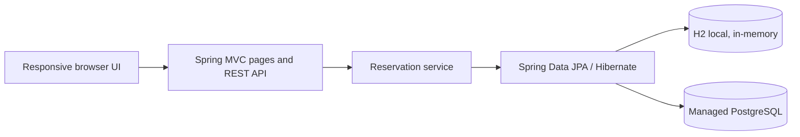

# Hotel Room Reservation System

A single-deployment academic reservation app for Full Stack Development – Unit V. Spring Boot serves the responsive website and JSON REST API. H2 is used for local development; PostgreSQL is supported for persistent deployments.

## Features

- Customer registration with required-field/email validation and unique email addresses.
- Six one-time seeded sample rooms with type, capacity, amenities, description and nightly price.
- Date-range availability from persisted reservations. Check-in is inclusive and check-out is exclusive; cancelled reservations do not block dates.
- Booking references, server-calculated totals, capacity/date validation, cancellation and status transitions.
- Room search, booking form, confirmation, booking lookup/cancellation and booking history in the browser.
- OpenAPI/Swagger UI at `/swagger-ui.html`.

## Technology and architecture

- Java 21, Spring Boot 3.3.5, Maven
- Spring MVC, Spring Data JPA, Hibernate, Bean Validation
- H2 local database and PostgreSQL production driver
- Thymeleaf page delivery, HTML/CSS/JavaScript, Bootstrap 5
- JUnit 5, Spring Boot Test and Mockito



Folders: `src/main/java/edu/academic/hotel` contains API, DTOs, entities, repositories, and reservation logic. `src/main/resources/templates` and `static` contain the website. `src/test` contains service tests.

## Prerequisites

- JDK 21 (the build targets Java 21; Java 21 or later can compile it)
- Maven 3.9+
- Optional: Docker Desktop / Docker Engine for the PostgreSQL compose setup

## Run locally

### Windows PowerShell

```powershell
cd hotel-room-reservation-system
$env:JAVA_HOME = 'C:\Path\To\jdk-21'
$env:Path = "$env:JAVA_HOME\bin;$env:Path"
mvn spring-boot:run
```

Open `http://localhost:8080`. H2 is created in memory and starts empty; the six sample rooms are inserted only when the room table is empty. Local reservations are lost when the process stops.

### Linux / macOS

```bash
cd hotel-room-reservation-system
export JAVA_HOME=/path/to/jdk-21
export PATH="$JAVA_HOME/bin:$PATH"
mvn spring-boot:run
```

### Maven commands

```text
mvn test                 Run automated service tests
mvn clean test           Clean compile and run tests
mvn clean package        Test and create executable JAR
mvn spring-boot:run      Run the local application
```

## PostgreSQL configuration

The app reads `DATABASE_URL`, `DB_USERNAME`, `DB_PASSWORD`, `PORT`, `SPRING_PROFILES_ACTIVE`, and `DDL_AUTO`. Copy `.env.example` values into your shell or hosting dashboard; never put real credentials into Git or frontend code. The datasource accepts JDBC URLs such as `jdbc:postgresql://localhost:5432/hotel` and managed service URLs with `postgres://` or `postgresql://` schemes. It converts managed PostgreSQL URLs to JDBC and reads URL-encoded user/password credentials when separate variables are not set. Separate `DB_USERNAME` and `DB_PASSWORD` take precedence.

The default `local` profile uses H2. `prod` uses the same environment-driven datasource with PostgreSQL configured by `DATABASE_URL`. Hibernate schema mode defaults to `update` for an easy academic demo; before a real production workload, replace automatic DDL with reviewed migrations (for example, Flyway) and set `DDL_AUTO=validate` after applying them. H2 is not persistent and must not be used for deployed reservations.

### Docker Compose (PostgreSQL + app)

From this directory run `docker compose up --build`. The demo database credentials in `docker-compose.yml` are local-only and must never be reused for a public database. The app will be at `http://localhost:8080`; the named database service is `db`.

## REST API

Swagger UI: `/swagger-ui.html`; OpenAPI JSON: `/v3/api-docs`.

| Method | Path | Purpose |
|---|---|---|
| GET | `/api/rooms` | List active rooms; optional `type` and `maxPrice` filters |
| GET | `/api/rooms/{id}` | Room details |
| GET | `/api/rooms/available?checkIn=2026-12-01&checkOut=2026-12-04&guests=2&type=Deluxe` | Search availability |
| POST | `/api/customers` | Register customer; duplicate email returns 409 |
| GET | `/api/customers/{id}` | Retrieve customer |
| POST | `/api/bookings` | Create a reservation |
| GET | `/api/bookings/{reference}` | Find a reservation by reference |
| GET | `/api/bookings` | Recent reservation history |
| PATCH | `/api/bookings/{reference}/cancel` | Cancel a confirmed reservation |
| PATCH | `/api/bookings/{reference}/status` | Mark a confirmed reservation completed |

Booking request (omit any client total; the server calculates it):

```json
{
  "roomId": 1,
  "fullName": "Avery Guest",
  "email": "avery@example.com",
  "phoneNumber": "+1 555 0100",
  "checkInDate": "2026-12-01",
  "checkOutDate": "2026-12-04",
  "numberOfGuests": 2
}
```

Successful creation returns `201 Created`, including a reference such as `HR-9DF37B49`, customer, room, dates, status and total. Example:

```json
{
  "bookingReference": "HR-9DF37B49",
  "checkInDate": "2026-12-01",
  "checkOutDate": "2026-12-04",
  "numberOfGuests": 2,
  "totalPrice": 357.00,
  "bookingStatus": "CONFIRMED"
}
```

Dates must be today or later and checkout must follow check-in. Invalid input returns 400, missing records 404, duplicate email or room/date conflicts 409. Error responses consistently include `status`, `error`, and `message` fields. A room row is locked while the service rechecks availability and writes the booking, reducing concurrent double-booking risk.

### Verify a reservation with curl

```bash
curl -X POST http://localhost:8080/api/bookings \
  -H 'Content-Type: application/json' \
  -d '{"roomId":1,"fullName":"Avery Guest","email":"avery@example.com","phoneNumber":"555-0100","checkInDate":"2026-12-01","checkOutDate":"2026-12-04","numberOfGuests":2}'

curl http://localhost:8080/api/bookings/HR-9DF37B49
curl -X PATCH http://localhost:8080/api/bookings/HR-9DF37B49/cancel
curl http://localhost:8080/api/bookings/HR-9DF37B49
```

Use dates that are in the future when you run these examples. The reference in the lookup/cancel commands must be the one returned by your POST.

## Build the JAR

```bash
mvn clean package
java -jar target/hotel-room-reservation-system-1.0.0.jar
```

The executable JAR respects the hosting `PORT` environment variable.

## Deploy publicly on Render

This repository includes `render.yaml` and a multi-stage Java 21 `Dockerfile`. Render supports Docker deployment for JVM applications and Blueprints can link a web service to a managed PostgreSQL connection string. The Blueprint selects a paid small web service and a small managed Postgres instance; confirm current pricing and choose a plan that fits your account before creating resources. Render plan names and pricing can change. See [Render Docker deployment](https://render.com/docs/docker), [Blueprint reference](https://render.com/docs/blueprint-spec), and [Render Postgres](https://render.com/docs/postgresql).

1. Push the project to a GitHub repository (steps below).
2. In Render, choose **New → Blueprint**, connect the repository, and select the branch containing `render.yaml`.
3. Review the web service and PostgreSQL resources and their current costs, then create the Blueprint.
4. Wait for the Docker build and deployment to finish. Render supplies `DATABASE_URL`, database credentials, and `PORT` through the Blueprint/environment.
5. Open the service URL shown in the Render dashboard. Confirm the landing page loads and try a future-date search and booking. The URL is the public website URL for Google Classroom.
6. Copy the public HTTPS URL from the web service page and submit that URL in GCR. A GitHub URL alone is not the deployed website.

The Render Postgres URL is a `postgresql://...` connection string. The app converts it to JDBC format; credentials stay in the service environment and are not embedded in the ZIP or browser code. Do not run the demo compose credentials on a public service.

## Push to GitHub

Create an empty repository in GitHub, then run these commands from this project directory (replace the remote URL):

```bash
git init
git add .
git commit -m "Build hotel room reservation system"
git branch -M main
git remote add origin https://github.com/YOUR-USERNAME/hotel-room-reservation-system.git
git push -u origin main
```

The `.gitignore` excludes `target`, `.env`, logs and IDE files. Check `git status` before pushing to confirm no credentials are staged.

## Tests and local verification

The project test suite exercises server-side customer validation/duplicate handling, booking totals and references, date and guest validation, overlap conflicts, cancellation, and availability query parameters. On 2026-10-27, `mvn test` completed with **6 tests, 0 failures, 0 errors** using the local JDK 25 runtime and Java 21 target. A direct local JAR smoke check also returned HTTP 200 for `/` and room APIs, returned six sample rooms, created a booking (total $357 for three nights at $119/night), then returned `CANCELLED` from both cancellation and reference lookup. See `TEST-REPORT.md` for the recorded commands.

## Demo security and limitations

This is an academic demo, not a commercial hotel system. There is no login, customer identity verification, staff role management, payment processing, rate limiting, audit trail, email confirmation, migration framework, or backup setup. Reservation references are random but are not an authorization mechanism; anyone who knows one can view or cancel that booking. Booking history is publicly readable. Add authentication/authorization and privacy controls before using real customer data. The room-row database lock helps serialize bookings for one room, but production concurrency and failure behavior should be load-tested with the chosen database. Remote images, fonts and Bootstrap are decorative/runtime dependencies; room cards include an image fallback and booking APIs remain usable without those images.
